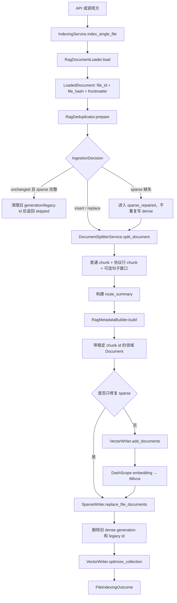
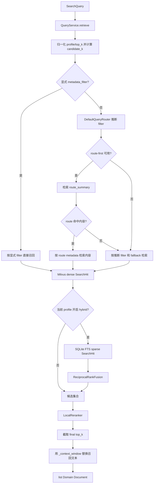

# RAG 模块代码与流程说明

`app/rag/` 负责知识文档的索引构建和查询。当前实现按领域模型、端口、用例编排和基础设施分层；索引与查询共享领域对象，但通过不同 Protocol 依赖外部存储。

本文以当前代码为准，重点说明两条主流程：

1. 索引构建：文件如何变成 Milvus 向量和 SQLite FTS 记录。
2. 查询：问题如何经过路由、稠密/稀疏召回、融合、重排，最终返回上下文。

## 1. 模块边界

```text
API / Tool / Agent
        │
        └── bootstrap.get_indexing_service() / get_query_service()
                              │
                    ┌─────────┴─────────┐
                    │                   │
          indexing/IndexingService  query/QueryService
                    │                   │
                    └────── ports/ ─────┘
                              │
                    infrastructure/
                 Milvus / SQLite / DashScope
```

依赖方向固定为：

```text
入口与组装层 → 用例层 → 领域模型与端口 ← 基础设施实现
```

`IndexingService`、`QueryService` 及其 contracts 不导入 Milvus、SQLite、OpenAI 或 LangChain 文档类型。`DocumentSplitterService` 可以在实现内部使用 LangChain splitter，但会在返回前转换为领域 `Document`；存储 SDK 类型集中在基础设施适配器，以及暂时保留的生命周期/兼容模块中。

### 1.1 目录职责

| 目录/文件 | 职责 |
| --- | --- |
| `models/` | RAG 自有的 `Document`、`SearchQuery`、`SearchHit`、`IndexingResult` |
| `ports/` | 用 `Protocol` 定义 embedding、向量写入/查询、稀疏写入/查询能力 |
| `indexing/` | 文件加载、去重、切分、元数据构建和索引编排 |
| `query/` | 查询路由、候选召回、RRF 融合、本地重排和查询编排 |
| `infrastructure/` | DashScope、Milvus、SQLite FTS5 的具体实现 |
| `bootstrap.py` | 惰性创建并缓存默认依赖，是应用的 composition root |
| `milvus_client.py` | 应用启动时连接数据库、创建/加载 collection，并为删除和优化提供底层 collection |
| `rag_taxonomy.py` | 设备、厂商、型号等 taxonomy 的推断与标准化 |
| `protocol_metadata.py` | 协议类型、寄存器地址、功能码等协议字段的提取与标准化 |

## 2. 公共领域模型

跨模块传递的是 `app.rag.models` 中的对象，而不是 LangChain 类型：

```python
Document(
    page_content: str,
    metadata: dict[str, Any],
    id: str | None,
)

SearchQuery(
    text: str,
    profile: RetrievalProfile | str,
    top_k: int | None,
    metadata_filter: dict[str, Any] | None,
)

SearchHit(
    document: Document,
    score: float,
    source: Literal["dense", "sparse", "fused"],
)
```

`RetrievalProfile` 支持：

- `chat`：通用知识查询。
- `aiops`：运维告警、排障、处理和验证流程。
- `protocol`：厂商协议、寄存器地址和功能码查询。

## 3. 索引构建模块

### 3.1 入口

当前入口统一通过组合根获得索引用例：

- 文件上传接口保存文件后，调用 `get_indexing_service().index_single_file()`。
- `POST /api/index_directory` 调用 `get_indexing_service().index_directory()`。
- 其他调用方也通过 `bootstrap.get_indexing_service()` 获得组装后的 `IndexingService`。

推荐新代码使用：

```python
from app.rag.bootstrap import get_indexing_service

service = get_indexing_service()
outcome = service.index_single_file("uploads/cpu-runbook.md")
result = service.index_directory("uploads")
```

索引编排逻辑只位于 `indexing/indexing_service.py`；项目不再提供 `VectorIndexService` 或全局 `vector_index_service`。

### 3.2 默认依赖组装

`bootstrap.get_indexing_service()` 注入以下实现：

| 用例依赖 | 默认实现 | 端口/契约 |
| --- | --- | --- |
| `loader` | `RagDocumentLoader` | `DocumentLoader` |
| `splitter` | `DocumentSplitterService` | `DocumentSplitter` |
| `metadata_builder` | `RagMetadataBuilder` | `MetadataBuilder` |
| `deduplicator` | `RagDeduplicator` | `Deduplicator` |
| `vector_writer` | `MilvusVectorStore`/兼容 `VectorStoreManager` | `VectorWriter` |
| `sparse_writer` | `SqliteSparseIndex`/兼容 `SparseIndexService` | `SparseWriter` |

这些对象由 `lru_cache` 复用。获得 `IndexingService` 本身不会连接 Milvus 或打开 SQLite：向量端口在首次实际读写时解析，sparse 端口由 `sparse_writer_factory` 在检查或同步 generation 时解析。sparse 初始化失败时记录 warning 并保持原有的 dense-only 降级行为。

### 3.3 单文件索引时序



具体步骤如下。

#### 步骤 1：加载文件

`RagDocumentLoader.load()`：

- 将路径转为绝对、标准化路径。
- 读取 UTF-8 原始字节和正文。
- 解析可选 Markdown frontmatter。
- 用标准化路径的 SHA-256 生成稳定 `file_id`。
- 用原始字节的 SHA-256 生成内容 `file_hash`。
- 返回 `LoadedDocument`，包含文件名、扩展名、大小、修改时间和 metadata。

#### 步骤 2：决定跳过、插入或替换

`RagDeduplicator.prepare()` 通过 `VectorWriter` 查询现有 generation：

| 条件 | action | 含义 |
| --- | --- | --- |
| 同一 `file_id + file_hash` 已存在 | `skip` | 文件内容未变化 |
| `file_id` 存在但 hash 改变 | `replace` | 先写新 generation，成功后删除旧 generation |
| 没有稳定 `file_id` | `insert` | 新文件；如果命中旧 `_source` 数据，记录其 legacy id 供后续清理 |

即使 dense 已存在，服务仍检查 SQLite sparse 索引是否包含同一 `file_id + file_hash`。如果 sparse 缺失，会进入 `sparse_repaired`，复用切分与元数据构建结果修复 sparse，而不重复写 dense。

#### 步骤 3：切分文档

`DocumentSplitterService.split_document()` 根据扩展名选择策略：

- `.md`：先按二级标题切分，再按 `chunk_size * 2` 做递归字符切分。
- `.txt`：直接使用递归字符切分器。
- 小于 300 字符的相邻片段可以合并，但不会跨不同 `h2` 或 `runbook_section`。
- Markdown 会识别 `alert_name` 和 `runbook_section`。
- Markdown 协议表格会额外生成 `document_type=protocol` 的行级 chunk。
- 开启 `rag_sentence_window_enabled` 时，较小句子作为召回文本，邻近内容写入 `_context_window`；否则写入普通 chunk index。

LangChain 分割器只在该实现内部使用，公开返回值统一转换为领域 `Document`。

#### 步骤 4：构建路由摘要

当 `rag_route_retrieval_enabled` 开启时，`IndexingService` 按 `route_key` 为内容 chunk 构建轻量 `route_summary`：

- `document_type=route_summary`。
- `target_document_type` 指向 `runbook`、`protocol` 或普通 `document`。
- 携带设备、厂商、型号、告警、协议、寄存器和标题路径等可路由字段。
- 同一文件内相同 `route_key` 只生成一份摘要。

查询模块先召回这类摘要，再用其 metadata 缩小正式内容查询范围。

#### 步骤 5：补全稳定元数据

`RagMetadataBuilder.build()` 为每个普通 chunk 和 route summary 统一补全：

- 文件 generation：`_file_id`、`_file_hash`、`_source`、`_file_name`。
- chunk 身份：`_chunk_id`、`_chunk_hash`、`_chunk_index`、`_chunk_count`。
- 索引信息：`_schema_version`、`_collection_name`、`_parser`、`_indexed_at`。
- 结构字段：`document_type`、`runbook_section`、`heading_path`、`route_key`。
- taxonomy：`device_type`、`manufacturer`、`model` 等。
- 协议字段：`protocol_type`、`register_address`、`register_name`、`function_code`、`data_type`、`unit`、`scale`、`read_write`、`description`。

`_chunk_id` 由文件 id、文件 hash、chunk 顺序和 chunk 内容 hash 共同生成，可作为 Milvus 稳定主键和 SQLite FTS 的关联键。

#### 步骤 6：写入 dense 与 sparse

1. `VectorWriter.add_documents()` 把领域 `Document` 转为 LangChain `Document`。
2. LangChain Milvus 调用 `EmbeddingProvider.embed_documents()`；默认实现是 `DashScopeEmbeddings`。
3. Milvus 使用 `_chunk_id` 作为主键，将正文、向量和 JSON metadata 写入 collection。
4. dense 写入成功后，`SparseWriter.replace_file_documents()` 在一个 SQLite 事务中写入当前文件全部 FTS5 记录，并删除该文件的过期 sparse chunk。
5. dense 和 sparse 都可用后，删除旧 dense generation 和已捕获的 legacy id。
6. 最后执行 collection flush/compact 的 best-effort 优化。

这个顺序避免了“先删除旧内容、新内容写入失败”造成知识暂时不可用。

### 3.4 失败与恢复语义

- 文件不存在或没有可索引 chunk：单文件索引抛出 `RuntimeError`。
- dense 写入失败：如果新 generation 可回滚，会尝试删除本次部分写入的数据，然后保留旧 generation。
- sparse 检查失败：按 sparse 缺失处理，进入修复流程。
- sparse 适配器无法创建：记录 warning，dense 索引仍可继续。
- sparse 同步在 dense 之后失败：旧 dense generation 尚未删除；重试时会识别 dense 已存在并修复 sparse。
- collection 优化失败：记录在 `optimization` 中，不回滚已完成的索引。
- `index_directory()` 只扫描目录第一层的 `.md` 和 `.txt`，逐文件隔离失败并返回 `IndexingResult` 统计。

## 4. 查询模块

查询已拆为独立的 `app/rag/query/` Pipeline。唯一的完整、随代码维护的说明见 [query/README.md](query/README.md)：其中包含入口/出口、`QueryRequest → QueryResult` 数据流、改写模式、`None` 与 `{}` filter 边界、route-first、dense/sparse/RRF、多 query 融合、降级语义、trace/CLI 和扩展 Protocol。

简要流程为：`get_query_engine()` / `QueryService.retrieve()` 接收请求，`Analyzer → RewritePolicy → Rule/LLM Rewriter → Planner → Executor → Reranker → context window` 输出领域 `Document`。`retrieve_knowledge` 仅在 tool 出口把领域文档转换为 LangChain artifact；项目没有直接 HTTP Query API。

新业务代码优先使用 `get_query_engine()` 的 `analyze`、`plan`、`query`，或兼容入口 `get_query_service().retrieve(SearchQuery)`。下面保留的索引文档只说明 RAG 的其他层；Query 的具体规则以 `query/README.md` 为准。

### 4.2 默认依赖组装

`bootstrap.get_query_service()` 注入：

| 用例依赖 | 默认实现 | 端口/契约 |
| --- | --- | --- |
| `vector_searcher` | `MilvusVectorStore` | `VectorSearcher` |
| `sparse_searcher` | `SqliteSparseIndex` | `SparseSearcher` |
| `router` | `DefaultQueryRouter` | `QueryRouter` |
| `fusion` | `ReciprocalRankFusion` | `RetrievalFusion` |
| `reranker` | `LocalReranker` | `Reranker` |

向量和 sparse 查询端口都采用惰性解析。普通 `chat` 查询未启用 hybrid 时不会初始化 SQLite；hybrid 查询中的 sparse 初始化或检索异常由 `QueryService` 捕获，并回退为 dense 结果。

### 4.3 查询时序



### 4.4 Profile、top-k 与候选数

`QueryService` 首先归一化 profile；未知值记录 warning 并回退到 `chat`。

- `aiops` 默认返回 `config.rag_aiops_top_k`。
- `chat` 和 `protocol` 默认返回 `config.rag_top_k`。
- `aiops`/`protocol` 候选数为 `max(top_k * 3, 15)`。
- `chat` 候选数为 `max(top_k * 2, 6)`。

候选数大于最终返回数，是为了给融合和重排保留空间。

### 4.5 Filter 推断与 route-first

#### 显式 filter

调用方传入 `metadata_filter` 时，服务直接使用该 filter，不再执行 route-first 或 query 推断。过滤搜索不支持或执行失败时不会偷偷退化为无过滤查询，避免跨设备、厂商或协议返回错误内容。

#### 自动推断

`DefaultQueryRouter.infer_metadata_filter()` 的默认规则：

- `protocol`：从 `document_type=protocol` 开始，追加设备 taxonomy 和协议/寄存器字段。
- `aiops`：从 `document_type=runbook` 开始，根据“排查、处理、验证”等词推断 `runbook_section`，再追加 taxonomy。
- `chat`：只推断 query 中明确出现的 taxonomy。

带 `manufacturer` 的 filter 会生成一个去掉厂商的 fallback。带设备、厂商、型号、寄存器地址或功能码的严格 taxonomy 查询在所有过滤结果为空时返回空列表，不回退成无过滤搜索。

#### route-first

当配置开启且向量适配器支持 metadata filter 时：

1. 先搜索 `document_type=route_summary`，并尽量携带 query 已推断出的设备/协议字段。
2. 从命中摘要读取 `target_document_type`、`route_key`、`_source` 和 taxonomy。
3. 生成正式内容 filter，再执行 dense/hybrid 内容查询。
4. route 摘要未命中时回退到 query 推断 filter。
5. route 命中但内容为空时继续尝试 filter fallback。

服务把 `_retrieval_filter`、`_retrieval_route` 和 route fallback 原因写入 metadata/trace，便于排查路由效果。

### 4.6 Dense、Sparse 与 RRF

#### Dense

`MilvusVectorStore.search()`：

1. 将安全的 metadata key/value 转为 Milvus JSON 表达式。
2. 调用 LangChain Milvus 相似度搜索。
3. 把 LangChain 结果转换为 `SearchHit(source="dense")`。
4. 原始分数标记为 distance，供 reranker 转成相关度。

非法 key、空 filter 或带 filter 的查询异常都会 fail closed，返回空候选，不执行无过滤回退。

#### Sparse

`SqliteSparseIndex.search_hits()` 使用 FTS5：

- 从 query 提取英文/数字/路径/寄存器形式和中文词项。
- 用 `OR` 组成 FTS 查询。
- 对允许的 metadata 字段追加 `json_extract` 条件。
- 返回 `SearchHit(source="sparse")`。

Sparse 异常只记录 warning，查询继续使用 dense 候选。

#### 融合

默认 `aiops`、`protocol` profile 开启 hybrid，具体由 `rag_hybrid_enabled` 和 `rag_hybrid_profiles` 控制。

`ReciprocalRankFusion` 按以下公式合并两个排名：

```text
RRF score(document) = Σ 1 / (rag_rrf_k + rank)
```

同一文档优先用 `_chunk_id` 去重，结果写入：

- `_retrieval_sources`：命中的 `dense`/`sparse` 渠道。
- `_retrieval_score_kind=relevance`：告诉后续 reranker 当前分数已经是越大越相关。

### 4.7 本地重排

`LocalReranker` 对每个候选计算：

```text
final_score = vector_relevance * 0.70
            + keyword_overlap * 0.20
            + metadata_boost * 0.10
```

- distance 分数转换为 `1 / (1 + distance)`；RRF relevance 分数直接使用。
- keyword 会比较 query 与正文、标题、告警、设备、厂商、协议、寄存器等字段。
- metadata boost 包括告警名、AIOps 重要章节、taxonomy、寄存器地址、功能码和标题命中。
- 单个候选重排异常时，只对该候选回退为向量相关度。

最终分数和 profile 写入 `_retrieval_score`、`_retrieval_profile`，按分数降序取 `final_top_k`。

### 4.8 上下文窗口与错误语义

如果命中 chunk 包含 `_context_window`：

- 返回正文替换成完整上下文窗口。
- 原始召回句子保存在 `_original_text`。
- metadata 和领域文档 id 保持不变。

整个查询位于 `rag_retrieve` trace span 中，记录 candidate-k、filter、route 是否尝试/命中和 fallback 原因。候选检索主流程出现未处理异常时记录错误并返回空列表；`retrieve_knowledge` 再把空结果转换成“没有找到相关信息”。

## 5. 如何替换实现而不改业务编排

索引和查询用例只依赖 Protocol，因此可以替换单个能力：

- 更换向量数据库：实现 `VectorWriter` 和 `VectorSearcher`。
- 更换 sparse 引擎：实现 `SparseWriter` 和 `SparseSearcher`。
- 更换 embedding：实现 `EmbeddingProvider`。
- 更换路由策略：实现 `QueryRouter`。
- 更换融合或重排：实现 `RetrievalFusion`、`Reranker`。
- 更换文件解析：实现 `DocumentLoader` 或 `DocumentSplitter`。

组装新实现时显式构造 `IndexingService`/`QueryService`，或者只在 `bootstrap.py` 修改默认 wiring。用例层不应导入 `app.rag.infrastructure`。

## 6. 入口与剩余兼容模块

以下旧入口已删除：

- `app.rag.vector_index_service.VectorIndexService`
- `app.rag.vector_index_service.vector_index_service`
- `app.rag.rag_retrieval_service.RagRetrievalService`
- `app.rag.rag_retrieval_service.rag_retrieval_service`

调用方现在只使用：

- `bootstrap.get_indexing_service()` → `IndexingService`。
- `bootstrap.get_query_service()` → `QueryService`。
- `SearchQuery` 表达查询参数，领域 `Document` 表达查询结果。

`app.services.*` 中与其他历史 RAG 组件对应的 shim、`app.core.milvus_client` 以及底层生命周期适配仍然存在，本次只移除了索引和查询两个顶层 facade。默认对象保持惰性连接，避免仅导入 `app.rag` 就连接 Milvus。

新增业务代码应优先导入 `app.rag.models`、`app.rag.ports`、`app.rag.indexing`、`app.rag.query` 和 `app.rag.bootstrap`。

## 7. 存储与索引现状

- Milvus collection 保存 `content`、`vector` 和 `metadata` JSON；物理 `id` 主键使用 `_chunk_id` 的值。
- 当前显式创建的是 `vector` 字段索引。
- metadata query 使用 Milvus JSON 表达式；尚未为 `metadata.document_type`、`metadata.route_key` 等子字段创建独立 scalar/JSON-path 索引。
- SQLite FTS5 是本地 sparse 索引，与 Milvus 通过 `_chunk_id`、`_file_id`、`_file_hash` 保持 generation 对齐。
- `route_summary` 是用于两阶段路由的特殊文档，不是独立数据库索引。

## 8. 测试导航

| 测试文件 | 保护内容 |
| --- | --- |
| `tests/test_rag_models.py` | 领域模型不依赖 LangChain |
| `tests/test_rag_ports.py` | Protocol 的结构化实现与签名 |
| `tests/test_rag_ingestion_pipeline.py` | 加载、去重、元数据、generation 替换与 sparse 同步 |
| `tests/test_document_splitter_runbook.py` | Markdown、runbook、协议表格和句子窗口切分 |
| `tests/test_vector_store_filtering.py` | Milvus filter、fail-closed 和领域结果转换 |
| `tests/test_sparse_index_service.py` | SQLite FTS 写入、替换和过滤查询 |
| `tests/test_rag_query_components.py` | router、RRF 和 reranker |
| `tests/test_rag_retrieval_service.py` | `QueryService` 的 route-first、hybrid、fallback、trace、上下文窗口和 tool artifact 边界 |
| `tests/test_rag_bootstrap.py` | 组合根的惰性后端初始化与 sparse 故障降级 |
| `tests/test_rag_architecture.py` | 用例层依赖方向、隔离导入和已删除入口约束 |
| `tests/test_compatibility.py` | 剩余 `app.services.*` shim 与旧公共对象 |

建议修改流程后至少运行：

```bash
pytest \
  tests/test_rag_ingestion_pipeline.py \
  tests/test_rag_query_components.py \
  tests/test_rag_retrieval_service.py \
  tests/test_rag_architecture.py -q
```
