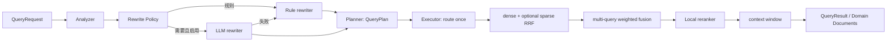

# 独立 Query Pipeline

`app/rag/query/` 是 RAG 的**查询决策与执行核心**。它只处理“用户的问题如何变成安全、可解释的检索计划，以及如何得到领域文档”，不直接依赖 FastAPI、LangChain、Milvus 或 Agent。这样可以单独运行、调试、替换其中任一步。

## 入口、出口与边界

| 入口 | 适用场景 | 输出/出口 |
| --- | --- | --- |
| `bootstrap.get_query_engine()` | 新代码、CLI、集成测试 | 组装好的 `QueryEngine`；端口和 LLM 都是惰性对象 |
| `QueryEngine.analyze(QueryRequest)` | 只看确定性理解结果 | `QueryAnalysis`，不访问存储 |
| `QueryEngine.plan(QueryRequest)` | 调试改写、filter、候选预算 | `QueryPlan`，不访问存储 |
| `QueryEngine.query(QueryRequest)` | 完整查询 | `QueryResult`，其中有领域 `Document`、计划和可选 trace |
| `bootstrap.get_query_service()` | 保持旧调用方式 | `QueryService` |
| `QueryService.retrieve(SearchQuery)` | 业务层兼容入口 | `list[app.rag.models.Document]`；失败返回空列表并写 span |
| `python -m app.rag.query.cli analyze|plan|run ...` | 人工调试 | 表格或 JSON；`analyze`/`plan` 不连接 store |
| `app.tools.retrieve_knowledge` | Agent/LangChain tool 出口 | 把领域文档转换为 LangChain `Document` artifact；这是框架转换边界 |

没有直接的 HTTP Query API。HTTP/API 或 Agent 必须经过上表的业务入口；`infrastructure/langchain_query_rewrite_model.py` 是允许导入 LangChain 的 LLM 适配器，不属于 Query core。

## 文件导航

| 文件 | 责任 |
| --- | --- |
| `models.py` | 不可变请求、分析、计划、trace 值对象，以及执行/结果对象 |
| `contracts.py` | 可替换组件的 `Protocol`：Analyzer、Policy、Rewriter、Planner、Executor、Debugger、Fusion、Router、Reranker |
| `analyzer.py` / `metadata_registry.py` | 规则理解、字段白名单、候选证据验证与 filter fallback 规则 |
| `rewrite_policy.py` / `rewriters/` | 是否使用 LLM 与规则/LLM 改写 |
| `planner.py` | 把理解结果冻结为纯内存 `QueryPlan` |
| `executor.py` | route-first、dense/sparse、融合、预算、降级 |
| `engine.py` | 编排各阶段、trace、rerank、上下文窗口和结果错误语义 |
| `query_service.py` | 旧 `SearchQuery -> list[Document]` facade 与 observability span |
| `cli.py` / `debugger.py` | 命令行检查、trace 脱敏和输出 |
| `query_router.py` / `retrieval_fusion.py` / `reranker.py` | 路由、RRF/多问题融合和本地重排实现 |

## 数据怎样流动



各阶段值对象依次为：`QueryRequest` → `QueryAnalysis` → `RewriteDecision` → `RewrittenQuery` → `QueryPlan` → `QueryExecution` → `QueryResult`。`QueryTraceEvent` 记录阶段开始/完成/失败/降级；只有请求 `debug=True` 时，`QueryResult.trace` 才返回给调用方。

### 1. 请求与分析

`QueryRequest` 包含 text、profile、top_k、显式 `metadata_filter`、最多由调用者提供的对话上下文、rewrite mode 和 debug 开关。`from_search_query()` 会复制 filter，避免共享调用方可变 dict。

`DefaultQueryAnalyzer` 不调用网络或 LLM：规范化文本，识别 AIOps 的 `troubleshooting`/`resolution`/`verification` intent，推断 taxonomy；protocol profile 还提取协议、寄存器、功能码。输出里的 `confidence`、`complexity`、`context_dependent` 与 `reasons` 是规则证据，供 policy 选择，不是模型解释。

`metadata_registry.py` 是 filter 的安全边界：只允许登记字段；别名会规范到 canonical 名称；LLM `EntityCandidate(field,value,evidence)` 必须有原问题或会话中的可验证证据，且通过 taxonomy/protocol 规范化。`strict` 字段（如 model、register_address、function_code）不能通过 fallback 放宽；只标为 `relaxable` 的字段才可能被移除。冲突的严格候选会使 plan 失败，而不会猜测一个范围。

**`None` 与 `{}` 不同：**`metadata_filter is None` 表示调用者未指定，planner 可以采用推断 filter 并 route-first；显式 `{}` 仍是调用者边界，`explicit_filter=True`，不会被补充或放宽。`QueryService` 为兼容旧 span 输出，会把最终 `{}` 表示为 `null`，这不改变 executor 的安全语义。

### 2. 改写决策

`RewriteMode` 可为：

- `off`：不使用 LLM，走规则改写。
- `rule`：显式要求规则改写。
- `llm`：仅当 `rag_query_llm_enabled=true` 时用 LLM；未启用时 policy 记录 `llm_disabled` 并走规则。
- `auto`：有显式非空 filter 时不改写；否则仅在低置信度、多 intent、上下文指代或 compound query 时使用 LLM。

LLM 不是启动时初始化的：`get_query_engine()` 注入 `_LazyPort(get_query_rewrite_model)`，只有 policy 真正选择 LLM 时才创建 chat model。LLM 输出必须满足长度、JSON 类型、置信度、保留技术实体、候选 evidence 等验证；任何失败会退回规则 rewriter，`RewrittenQuery.source="fallback"`，结果带 `llm_rewrite_failed` 降级原因。

### 3. 计划与检索

Planner 只计算，不访问 store。它决定 `final_top_k`、`candidate_k`、route/hybrid 开关、RRF k、route/sparse 深度、最多 dense attempts、query 列表与最终 filter。chat 的候选深度为 `max(top_k*2, 6)`；aiops/protocol 为 `max(top_k*3, 15)`。重写产生的 primary 权重为 `1.0`，每个 subquery 权重为 `0.6`；subquery 数和总 attempts 都有上限。

Executor 的顺序是：

1. 当 `route_first` 且向量端口支持 metadata filter 时，**只进行一轮** route-summary 检索（`route_k` 默认 2），再用摘要 metadata 试内容 filter。
2. route 未命中则尝试推断 filter 及 registry 允许的 fallback；显式 filter 不会被删改。严格 taxonomy/filter 空结果 fail-closed，不改为无 filter 检索。
3. 每个 logical attempt 是一次 dense 查询；若开启 hybrid，同行执行一次 sparse 查询（默认 sparse 深度至少 20），后者失败时保留 dense，标记 `sparse_search_failed`。
4. dense+sparse 使用 RRF；多个 query 的结果再按 1.0/0.6 weighted fusion。fusion 失败会稳定去重，而不是丢掉已有候选。
5. `LocalReranker` 重排后截断，`_context_window` 存在时以窗口替换正文并保留 `_original_text`。

可见降级包括 route miss、metadata filter 不支持、filtered search empty、dense/sparse 检索失败、预算耗尽、LLM 改写失败、reranker 失败与结果物化失败。若没有任何候选且 dense 失败，`QueryResult.error` 是脱敏后的摘要；`QueryService.retrieve()` 记录 `rag_retrieve` span 后返回 `[]`。不会把异常文本、凭据或未过滤重试泄漏给调用者。

## Debug、trace 与 CLI

Engine 总会在内存中记录安全 snapshot，外部 debugger 的异常不会影响检索。`MemoryQueryDebugger` 适合测试，`ConsoleQueryDebugger` 每行输出一个 JSON 事件；它会脱敏 token/password/secret 等字段，限制 document/content/preview，处理循环和非有限数字。默认 bootstrap 使用 `NoOpQueryDebugger`，因此**debug 不会自动打印**；CLI 的 run/debug 输出也取决于被注入的 debugger。

```bash
# 纯规则分析；不会建立 store
uv run python -m app.rag.query.cli analyze '华为逆变器告警怎么排查、处理并验证？' --profile aiops --format json

# 纯 planner；不会连接 store，明确使用 rule
uv run python -m app.rag.query.cli plan 'Modbus 寄存器地址 40001 功能码 03 是什么？' --profile protocol --rewrite-mode rule --format json

# 真正检索；可能懒加载向量、sparse 与（如 policy 选择）LLM
uv run python -m app.rag.query.cli run 'CPUHigh 怎么处理？' --profile aiops --debug --format json
```

## 默认配置

配置在 `app.config`，默认值为：`rag_query_rewrite_mode="off"`、`rag_query_llm_enabled=false`、`rag_query_llm_model=""`、`rag_query_llm_timeout_seconds=3.0`、`rag_query_rewrite_confidence_threshold=0.75`、`rag_query_max_subqueries=2`、`rag_query_max_retrieval_attempts=8`、`rag_query_debug_preview_length=240`。相关检索默认还有 `rag_route_retrieval_enabled=true`、`rag_route_top_k=2`、`rag_hybrid_enabled=true`、`rag_hybrid_profiles="aiops,protocol"`、`rag_rrf_k=60`、`rag_sparse_top_k=20`，以及项目既有 `rag_top_k`/`rag_aiops_top_k`。

## 如何扩展

优先实现 `contracts.py` 中的 Protocol，再在 bootstrap 注入：可替换 `QueryAnalyzer`、`RewritePolicy`、`QueryRewriter`、`QueryRewriteModel`、`QueryPlanner`、`QueryExecutor`、`QueryDebugger`、`MultiQueryFusion`；已有 `QueryRouter`、`RetrievalFusion`、`Reranker` 也可替换。核心不得导入基础设施或 Agent；适配 LangChain/其他 SDK 请放在 `app/rag/infrastructure/`。

## 验证命令

```bash
env DASHSCOPE_API_KEY=test-query-key uv run pytest \
  tests/test_query_*.py tests/test_rag_architecture.py tests/test_rag_query_components.py -q
env DASHSCOPE_API_KEY=test-query-key uv run ruff check app/rag/query \
  app/rag/infrastructure/langchain_query_rewrite_model.py tests/test_query_*.py
env DASHSCOPE_API_KEY=test-query-key uv run pyright app/rag/query \
  app/rag/infrastructure/langchain_query_rewrite_model.py
```
